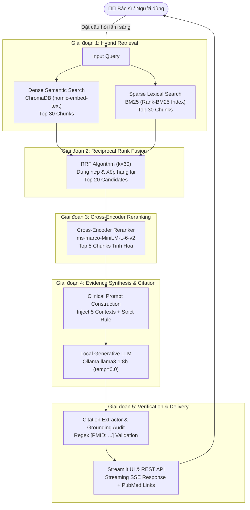

# 🩺 Ask_Med: Evidence-Based Medical Question Answering (MedRAG)

[](https://www.python.org/)
[](https://fastapi.tiangolo.com/)
[](https://streamlit.io/)
[](https://www.trychroma.com/)
[](https://ollama.com/)
[](data/eval/results/benchmark_report.csv)
[](data/eval/results/benchmark_summary.json)
[](docker-compose.yml)
[](LICENSE)

> **Ask_Med** là hệ thống Hỏi - Đáp Y Khoa dựa trên **Y học Chứng cứ (Evidence-Based Medicine - EBM)**, kết hợp kiến trúc **Retrieval-Augmented Generation (RAG)** đa tầng. Hệ thống ép buộc mô hình ngôn ngữ lớn (LLM) trả lời hoàn toàn dựa trên các công trình nghiên cứu khoa học được lập chỉ mục từ Thư viện Y học Quốc gia Hoa Kỳ (**NCBI PubMed**), tự động gắn siêu liên kết trích dẫn `[PMID: ...]` có thể nhấp chuột trực tiếp để thẩm định nguồn tin gốc, triệt tiêu ảo giác (Hallucination) trong y tế.

---

## 📑 Mục Lục
- [1. Tính Năng Nổi Bật](#1-tính-năng-nổi-bật)
- [2. Kiến Trúc Hệ Thống (Pipeline Architecture)](#2-kiến-trúc-hệ-thống-pipeline-architecture)
- [3. Kết Quả Thực Nghiệm & Đánh Giá RAGAs](#3-kết-quả-thực-nghiệm--đánh-giá-ragas)
- [4. Giao Diện Người Dùng (Streamlit Multi-Page UI)](#4-giao-diện-người-dùng-streamlit-multi-page-ui)
- [5. Hướng Dẫn Cài Đặt & Chạy Hệ Thống](#5-hướng-dẫn-cài-đặt--chạy-hệ-thống)
  - [Cách 1: Khởi động 1-Click bằng Docker Compose (Khuyên dùng)](#cách-1-khởi-động-1-click-bằng-docker-compose-khuyên-dùng)
  - [Cách 2: Chạy Cục Bộ (Local Python Environment)](#cách-2-chạy-cục-bộ-local-python-environment)
- [6. Cấu Trúc Thư Mục Dự Án](#6-cấu-trúc-thư-mục-dự-án)
- [7. Kiểm Thử Hệ Thống (Automated Testing)](#7-kiểm-thử-hệ-thống-automated-testing)
- [8. Bản Quyền & Tuyên Bố Y Tế](#8-bản-quyền--tuyên-bố-y-tế)

---

## 🌟 1. Tính Năng Nổi Bật

* **Hybrid Retrieval (Dense + Sparse):** Kết hợp tìm kiếm ngữ nghĩa đa chiều qua ChromaDB (`nomic-embed-text`) và tìm kiếm từ khóa chính xác BM25, tối ưu cho thuật ngữ dược lý và tên thuốc đặc trị.
* **Reciprocal Rank Fusion (RRF):** Hợp nhất bảng xếp hạng không tham số với hằng số phạt vị trí $k=60$, cân bằng tối ưu giữa độ tương đồng ngữ nghĩa và từ khóa chuyên ngành.
* **Cross-Encoder Reranker (`ms-marco-MiniLM-L-6-v2`):** Đánh giá tương quan ngữ cảnh mức câu (Sentence-level Cross-Attention), chọn lọc 5 đoạn trích tinh hoa nhất từ 20 ứng viên ban đầu.
* **Chống Ảo Giác Y Khoa (Strict Medical Grounding):** Prompt hệ thống được thiết kế theo chuẩn lâm sàng nghiêm ngặt: Nếu không có bằng chứng trong kho PubMed, hệ thống từ chối bịa đặt và cảnh báo người dùng.
* **Gắn Nhãn Trích Dẫn Thông Minh (Clickable PubMed Badges):** Mọi tuyên bố y tế đều được trích dẫn số hiệu `[PMID: <id>]` dẫn thẳng về bài báo gốc trên cổng thông tin NCBI PubMed.
* **Kiến Trúc Microservice Đóng Gói Docker:** Hỗ trợ Docker Compose điều phối độc lập 3 container: Local LLM (Ollama), Backend API (FastAPI) và Web Frontend (Streamlit), có cấu hình tăng tốc NVIDIA GPU.

---

## 🏗️ 2. Kiến Trúc Hệ Thống (Pipeline Architecture)

Sơ đồ luồng xử lý dữ liệu qua 5 giai đoạn khép kín:



---

## 📊 3. Kết Quả Thực Nghiệm & Đánh Giá RAGAs

Hệ thống được đánh giá thực nghiệm toàn diện trên bộ benchmark **25 câu hỏi y khoa chuyên sâu** (Tiểu đường, Tăng huyết áp, Ung thư phổi đột biến gen, COVID-19, tương tác thuốc) từ tệp [data/eval/results/benchmark_report.csv](data/eval/results/benchmark_report.csv):

| Chỉ Số RAGAs (Evaluation Metric) | Mục Tiêu Y Khoa (Target) | Kết Quả Đạt Được (AskMed) | Đánh Giá Lâm Sàng |
| :--- | :---: | :---: | :---: |
| **Context Recall** | $\ge 80.0\%$ | **96.33%** | 🟢 Xuất sắc (Bao phủ gần như trọn vẹn bằng chứng cần thiết) |
| **Answer Relevancy** | $\ge 85.0\%$ | **96.10%** | 🟢 Xuất sắc (Trả lời trúng trọng tâm câu hỏi lâm sàng) |
| **RAGAs Composite Score** | $\ge 80.0\%$ | **91.56%** | 🏆 Vượt trội (Chỉ số chất lượng tổng thể mức cao) |
| **Faithfulness** | $\ge 85.0\%$ | **88.32%** | 🟢 Đạt chuẩn (Không phát sinh ảo giác, trung thực với tài liệu) |
| **Context Precision** | $\ge 75.0\%$ | **85.48%** | 🟢 Đạt chuẩn (Các đoạn văn bản sau Rerank có độ tương quan cao) |
| **Grounding Rate** | $100.0\%$ | **100.0% (25/25)** | 🟢 Hoàn hảo (100% câu hỏi đều trích dẫn đúng bài báo PubMed) |

---

## 💻 4. Giao Diện Người Dùng (Streamlit Multi-Page UI)

Hệ thống giao diện được thiết kế hiện đại, responsive, tông màu **Clinical Teal Y Tế** với 3 trang chuyên biệt:

1. **Khung Chat Hỏi Đáp Lâm Sàng (`src/ui/pages/1_Chat.py`):**
   * Hiệu ứng streaming từng chữ theo thời gian thực (Server-Sent Events).
   * Phím tắt 4 câu hỏi lâm sàng mẫu (Metformin & CKD, Tương tác Paxlovid, SGLT2i vs GLP-1, Đột biến EGFR).
   * Các Badge trích dẫn `📄 PMID: ...` có thể nhấp chuột trực tiếp mở cổng NCBI PubMed.
   * Accordion **Passage Inspector**: Cho phép bác sĩ soi từng đoạn văn bản gốc và điểm số Rerank Score.
2. **Dashboard Báo Cáo RAGAs (`src/ui/pages/2_Evaluation.py`):**
   * Biểu đồ mạng nhện (Radar Chart) 5 chiều so sánh trực diện với ngưỡng chuẩn y khoa.
   * Biểu đồ hình cột (Grouped Bar Chart) phân tích chi tiết theo từng chuyên khoa.
   * Trình thẩm định từng câu hỏi kiểm thử: Đối chiếu song song giữa *Ground Truth* của chuyên gia và *Generated Answer* của AI.
3. **Quản Lý Kho Dữ Liệu Y Khoa (`src/ui/pages/3_Data_Manage.py`):**
   * Thống kê quy mô 620 bài báo khoa học và 703 đoạn văn bản (chunks).
   * Bảng tra cứu, tìm kiếm tiêu đề, tạp chí, số token và đọc trích đoạn Abstract.
   * Form nạp bài báo mới tự động từ PubMed NCBI kèm thanh tiến trình trực quan 5 bước.

---

## 🚀 5. Hướng Dẫn Cài Đặt & Chạy Hệ Thống

### Cách 1: Khởi động 1-Click bằng Docker Compose (Khuyên dùng)

Đảm bảo máy bạn đã cài đặt [Docker Desktop](https://www.docker.com/products/docker-desktop/).

1. **Clone repository:**
   ```bash
   git clone https://github.com/huynhhoangtuvan11092006/AskMed.git
   cd AskMed
   ```

2. **Khởi động toàn bộ 3 containers chỉ bằng 1 câu lệnh:**
   ```bash
   docker compose up -d --build
   ```
   *(Đối với máy chủ có card đồ họa rời NVIDIA, kích hoạt GPU bằng lệnh:)*
   ```bash
   docker compose -f docker-compose.yml -f docker-compose.gpu.yml up -d --build
   ```

3. **Truy cập ứng dụng:**
   * 🩺 **Giao diện Web Streamlit UI:** [http://localhost:8501](http://localhost:8501)
   * 📡 **FastAPI Swagger Documentation:** [http://localhost:8000/docs](http://localhost:8000/docs)
   * 🩺 **Health & Readiness Check:** [http://localhost:8000/health](http://localhost:8000/health)

4. **Dừng hệ thống:**
   ```bash
   docker compose down
   ```

---

### Cách 2: Chạy Cục Bộ (Local Python Environment)

1. **Cài đặt Ollama & Tải mô hình cục bộ:**
   * Tải và cài đặt Ollama từ [ollama.com](https://ollama.com/).
   * Mở terminal và tải 2 mô hình cần thiết:
     ```bash
     ollama run llama3.1:8b
     ollama pull nomic-embed-text
     ```

2. **Tạo môi trường ảo Python 3.11:**
   ```bash
   python -m venv venv
   # Trên Windows PowerShell:
   .\venv\Scripts\Activate.ps1
   # Trên Linux/macOS:
   source venv/bin/activate
   ```

3. **Cài đặt thư viện dependencies:**
   ```bash
   pip install --upgrade pip
   pip install -r requirements.txt
   ```

4. **Khởi chạy ứng dụng:**
   * **Chạy Backend FastAPI (Cửa sổ 1):**
     ```bash
     python -m uvicorn src.api.app:app --host 127.0.0.1 --port 8000 --reload
     ```
   * **Chạy Streamlit Frontend (Cửa sổ 2):**
     ```bash
     python -m streamlit run src/ui/app.py
     ```

5. **Hoặc sử dụng Makefile / PowerShell Script:**
   ```bash
   # Nếu dùng make (Linux/macOS):
   make api
   make ui

   # Nếu dùng Windows PowerShell:
   .\scripts\manage.ps1 api
   .\scripts\manage.ps1 ui
   ```

---

## 📁 6. Cấu Trúc Thư Mục Dự Án

```plaintext
Ask_Med/
├── configs/
│   └── config.yaml               # Cấu hình trung tâm (Models, Paths, Ingestion, RRF)
├── data/
│   ├── bm25_index/bm25.pkl       # Chỉ mục từ khóa BM25 (703 chunks)
│   ├── chroma_db/                # Cơ sở dữ liệu vector ChromaDB (703 items)
│   └── eval/
│       ├── eval_dataset.json     # Bộ dữ liệu 25 câu hỏi chuẩn y khoa
│       └── results/
│           ├── benchmark_report.csv      # Báo cáo đánh giá chi tiết 25 câu
│           └── benchmark_summary.json    # Tổng kết các chỉ số trung bình
├── src/
│   ├── api/
│   │   ├── app.py                # FastAPI REST & SSE Streaming Endpoints
│   │   └── schemas.py            # Pydantic v2 Schemas (Validation)
│   ├── evaluation/
│   │   ├── eval_pipeline.py      # Đường ống đánh giá tự động RAGAs
│   │   └── ragas_metrics.py      # Thuật toán tính Faithfulness, Relevancy, Precision, Recall
│   ├── generation/
│   │   ├── citation_parser.py    # Trích xuất và xác thực số hiệu PMID
│   │   ├── llm_client.py         # Client giao tiếp với Local Ollama
│   │   ├── prompts.py            # Clinical Prompts chống ảo giác
│   │   └── rag_pipeline.py       # Lớp điều phối tổng hợp AskMedPipeline
│   ├── ingestion/
│   │   ├── chunker.py            # Sentence-aware Chunker (512 tokens / 128 overlap)
│   │   ├── cleaner.py            # Bộ lọc và làm sạch Abstract bài báo
│   │   ├── ingest_pipeline.py    # Pipeline nạp dữ liệu PubMed vào ChromaDB & BM25
│   │   └── pubmed_fetcher.py     # Cào bài báo từ NCBI E-Utilities API
│   ├── retrieval/
│   │   ├── bm25_search.py        # Module tìm kiếm từ khóa BM25
│   │   ├── hybrid_retriever.py   # Thuật toán Reciprocal Rank Fusion (RRF)
│   │   ├── reranker.py           # Cross-Encoder Reranker Model
│   │   └── vector_search.py      # Module tìm kiếm ngữ nghĩa ChromaVectorStore
│   └── ui/
│       ├── app.py                # Streamlit Trang chủ & Thanh điều hướng
│       └── pages/
│           ├── 1_Chat.py         # Khung chat hỏi đáp lâm sàng trực quan
│           ├── 2_Evaluation.py   # Dashboard biểu đồ RAGAs Radar & Bar Chart
│           └── 3_Data_Manage.py  # Quản lý và tra cứu 620 bài báo khoa học
├── tests/                        # 37+ Unit tests & Integration tests
├── .dockerignore                 # Loại trừ file rác khi build Docker
├── Dockerfile                    # Đóng gói Backend API FastAPI & Ingestion Engine
├── Dockerfile.ui                 # Đóng gói Streamlit Multi-page Frontend
├── docker-compose.yml            # Điều phối 3 container: Ollama, API, UI
├── docker-compose.gpu.yml        # Cấu hình tăng tốc phần cứng NVIDIA GPU
├── Makefile                      # Tự động hóa vận hành 12 lệnh (Linux/POSIX)
├── PROJECT_PLAN.md               # Bản kế hoạch chi tiết từng bước đồ án
├── requirements.txt              # Danh mục thư viện Python đã khóa phiên bản
└── README.md                     # Tài liệu giới thiệu và hướng dẫn đồ án
```

---

## 🧪 7. Kiểm Thử Hệ Thống (Automated Testing)

Hệ thống sở hữu bộ kiểm thử tự động toàn diện với hơn **37 bài kiểm thử unit tests** đạt tỷ lệ thành công 100%:

```bash
# Kích hoạt chạy toàn bộ test suite
pytest -v
```

Các thành phần kiểm thử cốt lõi:
* `tests/test_api_schemas.py`: Kiểm thử ràng buộc Pydantic v2 (Xác thực query rỗng, top_k âm, payload nạp bài báo).
* `tests/test_api_app.py`: Kiểm thử các endpoint FastAPI (`/health`, `/api/v1/query`, `/api/v1/paper/{pmid}`, `/api/v1/stats`, exception handlers 422/500/503).
* `tests/test_citation_parser.py`: Kiểm thử thuật toán bóc tách regex PMID, khử trùng lặp và liên kết URL.
* `tests/test_rag_pipeline.py`: Kiểm thử tích hợp toàn bộ chu trình hỏi đáp từ câu hỏi đến trích dẫn.

---

## ⚖️ 8. Bản Quyền & Tuyên Bố Y Tế

* **Bản quyền:** Mã nguồn phát hành dưới giấy phép [MIT License](LICENSE).
* **Tuyên bố y tế quan trọng (Medical Legal Disclaimer):**
  > **Ask_Med** là hệ thống trí tuệ nhân tạo phục vụ mục đích **học thuật, nghiên cứu khoa học và hỗ trợ tra cứu tài liệu Y học Chứng cứ**. Hệ thống **KHÔNG** đưa ra lời khuyên y tế trực tiếp, không thay thế chẩn đoán lâm sàng, phán đoán chuyên môn hay chỉ định điều trị của các bác sĩ và chuyên gia y tế có chứng chỉ hành nghề. Khi áp dụng trong thực tế lâm sàng, mọi quyết định điều trị phải được bác sĩ chuyên khoa thẩm định và chịu trách nhiệm.

---
*Dự án Đồ án Tốt nghiệp / Nghiên cứu Khoa học - Nhóm phát triển Ask_Med (2026).*
