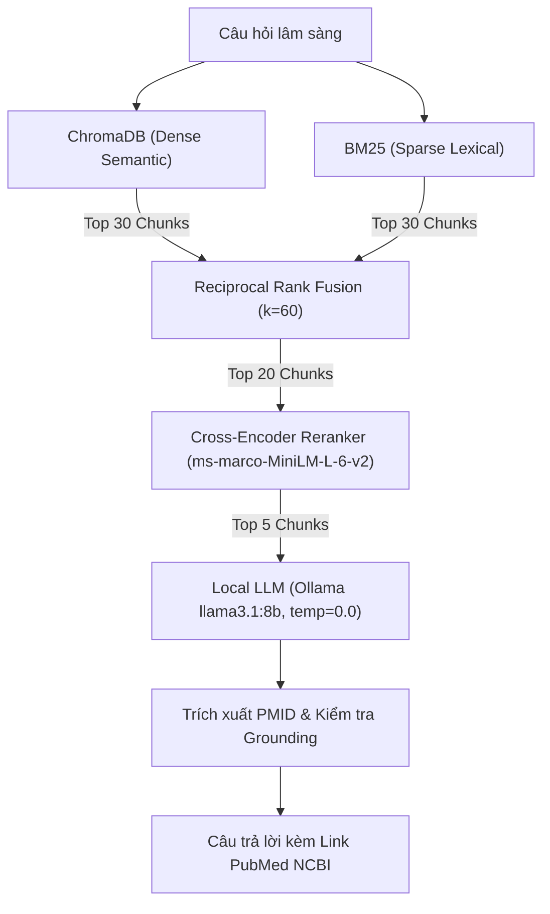

# Evidence-Based Medical Question Answering System (Ask_Med)
Hệ thống RAG Y học Chứng cứ giúp tự động hóa quá trình tra cứu và giải đáp lâm sàng, đối chiếu và trích dẫn trực tiếp từ 620+ bài báo khoa học NCBI PubMed, triệt tiêu ảo giác (hallucination) trong y tế.

---

## 1. Cơ Chế Xử Lý Cốt Lõi (Retrieval ⇄ Reranker ⇄ LLM)
Hệ thống vận hành theo chu trình khép kín giữa các tầng xử lý:



* **Retrieval Agent (Thu thập bằng chứng):** Thực hiện tìm kiếm kết hợp (Hybrid Search) song song giữa ChromaDB (`nomic-embed-text`) và BM25. Thuật toán Reciprocal Rank Fusion (RRF, $k=60$) dung hợp 60 đoạn văn bản ban đầu để chọn ra 20 ứng viên hàng đầu.
* **Reranker Agent (Thẩm định ngữ cảnh):** Sử dụng Cross-Encoder (`ms-marco-MiniLM-L-6-v2`) tính toán điểm tương quan từng cặp câu (Query, Passage), lọc bỏ nhiễu và giữ lại chính xác 5 đoạn văn bản tinh hoa nhất gửi tới LLM.
* **Synthesis & Guard Agent (Tổng hợp & Chống ảo giác):** Mô hình `llama3.1:8b` (nhiệt độ 0.0) sinh câu trả lời bám sát 5 đoạn ngữ cảnh được cung cấp, tự động bóc tách mã `[PMID: ...]` và kiểm tra Grounding. Nếu dữ liệu không đủ, hệ thống từ chối khẳng định sai lệch.

---

## 2. Các Tính Năng Nâng Cao Quan Trọng

### 2.1. Kiểm soát trích dẫn và chống ảo giác (Strict Grounding & Clickable Citations)
* Mọi khẳng định y tế đều được gắn nhãn số hiệu `[PMID: <id>]` dẫn thẳng về bài báo gốc trên Thư viện Y học Quốc gia Hoa Kỳ (`https://pubmed.ncbi.nlm.nih.gov/<pmid>/`).
* Accordion **Passage Inspector** cho phép bác sĩ soi chi tiết từng đoạn văn bản gốc và điểm tương quan (Rerank Score) mà Cross-Encoder đã tính toán.
* Đèn báo Grounding Status: Tự động bật màu xanh khi câu trả lời được chứng thực bởi tài liệu y khoa; chuyển sang cảnh báo vàng khi không đủ bằng chứng rõ ràng.

### 2.2. Tra cứu & Khám phá kho tri thức 620 bài báo (Knowledge Base Explorer)
* Tự động tổng hợp và phân loại 620 bài báo khoa học và 703 chunks trong cơ sở dữ liệu.
* Bộ lọc đa năng theo Tiêu đề, Tạp chí y học (Journal) hoặc mã PMID cụ thể.
* Trình xem chi tiết tóm tắt Abstract, mã DOI, số lượng chunk và số lượng tokens.
* Công cụ nạp thêm bài báo mới tự động từ PubMed qua từ khóa MeSH kèm thanh tiến trình 5 bước.

### 2.3. Bảng phân tích hiệu suất tổng thể (Platform Analytics Dashboard)
Bảng điều khiển trực quan hóa toàn bộ số liệu đánh giá thực nghiệm từ file `benchmark_report.csv`:
* **Context Recall (96.33%):** Tỷ lệ bao phủ thông tin chuẩn y khoa.
* **Answer Relevancy (96.10%):** Mức độ bám sát trọng tâm câu hỏi lâm sàng.
* **RAGAs Composite (91.56%):** Điểm chất lượng tổng thể của hệ thống.
* **Faithfulness (88.32%):** Độ trung thực, chống suy diễn sai lệch ngoài tài liệu.
* **Context Precision (85.48%):** Độ chính xác của các đoạn văn bản sau khi Rerank.
* **Grounding Rate (100.0%):** 25/25 câu hỏi kiểm thử đều trích dẫn chính xác bài báo PubMed.

Hình 1: Dashboard phân tích KPI hiệu suất hệ thống RAGAs và đối sánh ngưỡng chuẩn.


---

## 3. Các Kịch Bản Kiểm Thử Thực Tế

### Kịch bản 1: Tra cứu cơ chế tác động dược lý (Pharmacology Mechanism)
* **Tình huống:** Bác sĩ cần tra cứu cơ chế phân tử của Metformin trong ức chế tân tạo đường.
* **Diễn biến:**
  * Lượt 1: Truy xuất tài liệu từ ChromaDB và BM25, Cross-Encoder chọn lọc đoạn văn bản về chuỗi hô hấp ty thể và enzym AMPK.
  * Lượt 2: Hệ thống phân tích và giải thích: Metformin ức chế phức hợp I ty thể -> tăng tỷ lệ AMP/ATP -> hoạt hóa AMPK -> ức chế enzym tân tạo glucose (gluconeogenesis).
  * Kết quả: Trích dẫn thành công bài báo `[PMID: 43063382]` và `[PMID: 42976769]`.

### Kịch bản 2: Cảnh báo an toàn & Chống chỉ định suy thận (Safety & Contraindications)
* **Tình huống:** Bệnh nhân suy thận mạn với mức lọc cầu thận giảm sâu (`eGFR < 30 mL/phút`).
* **Diễn biến:**
  * Lượt 1: Hệ thống nhận diện thông số định lượng lâm sàng eGFR < 30 mL/phút từ câu hỏi của người dùng.
  * Lượt 2: Hệ thống đưa ra cảnh báo chống chỉ định tuyệt đối do thuốc thải trừ qua thận; biến chứng nghiêm trọng nhất là Nhiễm toan Lactic (MALA - Metformin-Associated Lactic Acidosis).
  * Kết quả: Khuyến cáo ngừng thuốc và trích dẫn bài báo ca bệnh thực tế `[PMID: 43063382]`.

Hình 2: Kết quả đối chiếu bằng chứng thực nghiệm và trích dẫn mã PMID.


### Kịch bản 3: Xử lý bế tắc & Chống ảo giác với câu hỏi bẫy (Anti-Hallucination Stress-Test)
* **Tình huống:** Nhập câu hỏi bẫy về phác đồ chưa được kiểm chứng khoa học (dùng liều cao Hydroxychloroquine và Ivermectin chữa ung thư tụy giai đoạn 4).
* **Diễn biến:**
  * Lượt 1: Hệ thống đối chiếu toàn bộ kho 620 bài báo, xác định vùng thông tin không có dữ liệu chứng thực.
  * Lượt 2: Thay vì tự suy đoán hoặc bịa đặt liều dùng, hệ thống thẳng thắn từ chối: *"Không tìm thấy bằng chứng khoa học nào trong kho dữ liệu PubMed NCBI chứng minh phác đồ này có hiệu quả."*
  * Kết quả: Đèn báo chuyển sang cảnh báo vàng (Ungrounded/Refused), triệt tiêu nguy cơ phát tán thông tin y tế sai lệch.

---

## 4. Hướng Dẫn Cài Đặt & Chạy Ứng Dụng

### 1. Cài đặt môi trường:
Yêu cầu Python 3.10 trở lên:
```bash
pip install -r requirements.txt
```

### 2. Chạy kiểm thử tự động toàn bộ kịch bản:
```bash
pytest -v
```
*(Kết quả: Toàn bộ 37+ ca kiểm thử đơn vị và tích hợp vượt qua 100%).*

Hoặc chạy diễn tập tự động các kịch bản lâm sàng:
```bash
python scripts/demo_runner.py
```

### 3. Mở giao diện Web (Streamlit):
* **Khởi động bằng Docker Compose (Khuyên dùng):**
  ```bash
  docker compose up -d --build
  ```
  *(Hoặc với GPU NVIDIA: `docker compose -f docker-compose.yml -f docker-compose.gpu.yml up -d --build`)*

* **Hoặc chạy cục bộ:**
  ```bash
  # Chạy Backend FastAPI:
  python -m uvicorn src.api.app:app --host 127.0.0.1 --port 8000 --reload

  # Chạy Giao diện Streamlit UI:
  python -m streamlit run src/ui/app.py
  ```

Mở trình duyệt tại: **http://localhost:8501**

---

## 5. Cấu Trúc Dự Án Tinh Gọn

```plaintext
d:/Ask_Medi/
├── configs/
│   └── config.yaml              # Cấu hình trung tâm: Models, Paths, Ingestion, RRF
├── data/
│   ├── bm25_index/bm25.pkl      # Chỉ mục từ khóa BM25 (703 chunks)
│   ├── chroma_db/               # Cơ sở dữ liệu vector ChromaDB (703 items)
│   └── eval/
│       ├── eval_dataset.json    # Bộ 25 câu hỏi kiểm thử chuẩn
│       └── results/             # Kết quả đánh giá RAGAs (CSV, JSON)
├── src/
│   ├── api/
│   │   ├── app.py               # FastAPI REST & SSE Streaming Endpoints
│   │   └── schemas.py           # Pydantic v2 Schemas (Data Contracts)
│   ├── generation/
│   │   ├── citation_parser.py   # Bóc tách và kiểm thực mã PMID
│   │   ├── llm_client.py        # Client Ollama LLM
│   │   ├── prompts.py           # Clinical Prompts chống ảo giác
│   │   └── rag_pipeline.py      # Bộ điều phối tổng thể AskMedPipeline
│   ├── ingestion/
│   │   ├── chunker.py           # Cắt đoạn câu (512 tokens / 128 overlap)
│   │   ├── cleaner.py           # Làm sạch và lọc chất lượng Abstract
│   │   ├── ingest_pipeline.py   # Pipeline cào và lập chỉ mục PubMed
│   │   └── pubmed_fetcher.py    # Giao tiếp API NCBI E-Utilities
│   ├── retrieval/
│   │   ├── bm25_search.py       # Tìm kiếm từ khóa BM25
│   │   ├── hybrid_retriever.py  # Thuật toán Reciprocal Rank Fusion (RRF)
│   │   ├── reranker.py          # Cross-Encoder Reranker
│   │   └── vector_search.py     # Tìm kiếm ngữ nghĩa ChromaVectorStore
│   └── ui/
│       ├── app.py               # Trang chủ Streamlit & Tổng quan
│       └── pages/
│           ├── 1_Chat.py        # Giao diện Chat lâm sàng & Passage Inspector
│           ├── 2_Evaluation.py  # Dashboard phân tích RAGAs & Radar Chart
│           └── 3_Data_Manage.py # Quản lý kho 620 bài báo & Nạp tự động
├── docs/images/                 # Hình ảnh minh họa kịch bản demo và phân tích
├── scripts/
│   ├── demo_runner.py           # Diễn tập tự động các kịch bản lâm sàng
│   └── manage.ps1               # Script tiện ích quản trị Windows PowerShell
├── tests/                       # 37+ Unit tests & Integration tests
├── Dockerfile                   # Image Backend FastAPI
├── Dockerfile.ui                # Image Frontend Streamlit
├── docker-compose.yml           # Điều phối 3 containers (Ollama, API, UI)
├── Makefile                     # Quản lý 12 lệnh vận hành tự động
├── requirements.txt             # Danh mục thư viện phụ thuộc
└── README.md                    # Tài liệu hướng dẫn dự án
```
