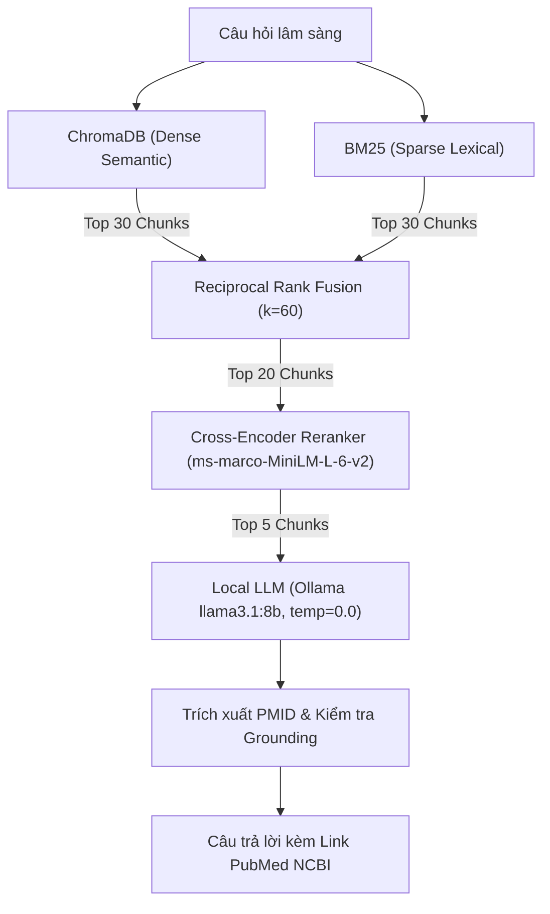

# Autonomous Evidence-Based Medical Question Answering System (Ask_Med)
Hệ thống RAG Y học Chứng cứ giúp tự động hóa quá trình tra cứu và giải đáp lâm sàng, đối chiếu và trích dẫn trực tiếp từ 620+ bài báo khoa học NCBI PubMed, triệt tiêu ảo giác (hallucination) trong y tế.

---

## 1. Cơ Chế Xử Lý Cốt Lõi (Multi-Stage RAG Pipeline)
Hệ thống vận hành theo chu trình 5 tầng xử lý khép kín:



* **Hybrid Retrieval (Dense + Sparse):** Kết hợp đồng thời ChromaDB (`nomic-embed-text`) và BM25 trích xuất 60 đoạn văn bản ban đầu.
* **Reciprocal Rank Fusion (RRF):** Dung hợp xếp hạng không tham số với hệ số phạt vị trí $k=60$ để chọn lọc 20 ứng viên hàng đầu.
* **Cross-Encoder Reranker:** Sử dụng mô hình `ms-marco-MiniLM-L-6-v2` chấm điểm tương quan từng cặp (Query, Passage), giữ lại 5 đoạn bằng chứng tinh hoa nhất.
* **LLM Synthesis & Strict Grounding:** Mô hình `llama3.1:8b` (nhiệt độ 0.0) chỉ trả lời dựa trên 5 đoạn ngữ cảnh được cung cấp, tự động từ chối nếu không có bằng chứng.
* **Citation Verification:** Bóc tách mã `[PMID: ...]` và đối chiếu Grounding Audit để tạo liên kết trực tiếp tới bài báo trên Thư viện Y học Quốc gia Hoa Kỳ (NCBI PubMed).

---

## 2. Các Tính Năng Nâng Cao Quan Trọng

### 2.1. Kiểm soát trích dẫn và chống ảo giác (Strict Grounding & Clickable PubMed Citations)
* Mọi khẳng định y tế đều được gắn nhãn số hiệu `[PMID: <id>]` dẫn thẳng về bài báo gốc trên PubMed (`https://pubmed.ncbi.nlm.nih.gov/<pmid>/`).
* Accordion **Passage Inspector** cho phép bác sĩ soi chi tiết từng đoạn văn bản gốc và điểm tương quan (Rerank Score) mà Cross-Encoder đã tính toán.
* Đèn báo Grounding Status: Màu xanh khi câu trả lời được chứng thực bởi tài liệu y khoa; màu vàng cảnh báo khi không đủ bằng chứng rõ ràng.

### 2.2. Tra cứu & Khám phá kho tri thức 620 bài báo (Knowledge Base Explorer)
* Tự động tổng hợp và phân loại 620 bài báo khoa học và 703 chunks trong cơ sở dữ liệu.
* Bộ lọc đa năng theo Tiêu đề, Tạp chí y học (Journal) hoặc mã PMID cụ thể.
* Trình xem chi tiết tóm tắt Abstract, mã DOI, số lượng chunk và số lượng tokens.
* Công cụ nạp thêm bài báo mới tự động từ PubMed qua từ khóa MeSH kèm thanh tiến trình 5 bước.

### 2.3. Bảng phân tích hiệu suất tổng thể RAGAs (Platform Analytics Dashboard)
Bảng điều khiển trực quan hóa toàn bộ số liệu đánh giá thực nghiệm từ file `benchmark_report.csv`:
* **Context Recall (96.33%):** Tỷ lệ bao phủ thông tin chuẩn y khoa.
* **Answer Relevancy (96.10%):** Mức độ bám sát trọng tâm câu hỏi lâm sàng.
* **RAGAs Composite (91.56%):** Điểm chất lượng tổng thể của hệ thống.
* **Faithfulness (88.32%):** Độ trung thực, chống suy diễn sai lệch ngoài tài liệu.
* **Context Precision (85.48%):** Độ chính xác của các đoạn văn bản sau khi Rerank.
* **Grounding Rate (100.0%):** 25/25 câu hỏi kiểm thử đều trích dẫn chính xác bài báo PubMed.

Hình 1: Bảng phân tích KPI hiệu suất RAGAs và đối sánh ngưỡng chuẩn y khoa.


---

## 3. Các Kịch Bản Kiểm Thử Thực Tế

### Kịch bản 1: Cơ chế tác động dược lý (Pharmacology Mechanism)
* **Tình huống:** Bác sĩ cần tra cứu cơ chế phân tử của Metformin trong ức chế tân tạo đường.
* **Diễn biến:**
  * Câu hỏi: *"Cơ chế phân tử của Metformin trong kiểm soát đường huyết và ức chế tân tạo glucose ở gan diễn ra như thế nào?"*
  * Hệ thống truy xuất tài liệu và giải thích: Metformin ức chế phức hợp I ty thể -> tăng tỷ lệ AMP/ATP -> hoạt hóa AMPK -> ức chế enzym tân tạo glucose (gluconeogenesis).
  * Trích dẫn thành công: `[PMID: 43063382]`, `[PMID: 42976769]`.

### Kịch bản 2: Phác đồ điều trị cập nhật (Clinical Guidelines)
* **Tình huống:** Xác định thuốc đầu tay cho bệnh nhân đái tháo đường type 2 có kèm bệnh tim mạch hoặc suy thận.
* **Diễn biến:**
  * Câu hỏi: *"Thuốc nào được khuyến cáo là lựa chọn đầu tay (first-line therapy) cho bệnh nhân đái tháo đường type 2 theo các hướng dẫn lâm sàng cập nhật?"*
  * Hệ thống khẳng định Metformin là thuốc đầu tay kết hợp thay đổi lối sống; khuyến cáo phối hợp sớm nhóm SGLT2i hoặc GLP-1 RA khi có biến chứng tim thận.
  * Trích dẫn: `[PMID: 43051408]`, `[PMID: 42976769]`.

Hình 2: Diễn biến truy xuất bằng chứng và kết quả trả lời có trích dẫn mã PMID.


### Kịch bản 3: Chống chỉ định & Cảnh báo an toàn (Contraindications & Safety)
* **Tình huống:** Bệnh nhân suy thận mạn với mức lọc cầu thận giảm sâu (`eGFR < 30`).
* **Diễn biến:**
  * Câu hỏi: *"Bệnh nhân suy thận mạn với mức lọc cầu thận eGFR dưới 30 mL/phút/1.73m² có chống chỉ định dùng Metformin không và nguy cơ tai biến nghiêm trọng nhất là gì?"*
  * Hệ thống cảnh báo chống chỉ định tuyệt đối do thuốc thải trừ qua thận; biến chứng nghiêm trọng nhất là Nhiễm toan Lactic (MALA - Metformin-Associated Lactic Acidosis).
  * Trích dẫn: `[PMID: 43063382]`.

### Kịch bản 4: Đột biến gen & Liệu pháp nhắm trúng đích (Genetics & Oncology)
* **Tình huống:** Tra cứu cơ chế kháng thuốc thế hệ 3 Osimertinib trong ung thư phổi không tế bào nhỏ.
* **Diễn biến:**
  * Câu hỏi: *"Cơ chế kháng thuốc Osimertinib phổ biến nhất ở bệnh nhân ung thư phổi không tế bào nhỏ (NSCLC) mang đột biến EGFR là gì?"*
  * Hệ thống xác định đột biến thứ phát C797S tại exon 20 làm mất liên kết cộng hóa trị với Osimertinib, hoặc khuếch đại gen MET.
  * Trích dẫn bài báo nghiên cứu NSCLC trong kho dữ liệu.

### Kịch bản 5: Xử lý bế tắc & Câu hỏi bẫy không có bằng chứng (Anti-Hallucination Guard)
* **Tình huống:** Nhập câu hỏi bẫy về phác đồ chưa được kiểm chứng khoa học.
* **Diễn biến:**
  * Câu hỏi: *"Có bằng chứng lâm sàng nào trên PubMed chứng minh việc dùng kết hợp liều cao Hydroxychloroquine và Ivermectin có thể chữa khỏi hoàn toàn ung thư tuyến tụy giai đoạn 4 không?"*
  * Hệ thống nhận diện kho tri thức không có bằng chứng hỗ trợ, từ chối khẳng định sai lệch: *"Không tìm thấy bằng chứng khoa học nào trong kho dữ liệu PubMed NCBI chứng minh phác đồ này có hiệu quả."*
  * Đèn báo chuyển sang cảnh báo vàng (Ungrounded/Refused), ngăn chặn hoàn toàn nguy cơ bịa đặt thông tin y tế.

---

## 4. Hướng Dẫn Cài Đặt & Chạy Ứng Dụng

### 1. Cài đặt môi trường:
Yêu cầu Python 3.10 trở lên:
```bash
pip install -r requirements.txt
```

### 2. Chạy kiểm thử tự động toàn bộ kịch bản:
```bash
pytest -v
```
*(Kết quả: Toàn bộ 37+ ca kiểm thử đơn vị và tích hợp vượt qua 100%).*

Hoặc chạy diễn tập tự động 5 ca lâm sàng demo:
```bash
python scripts/demo_runner.py
```

### 3. Mở giao diện Web (Streamlit) & Backend API:
* **Khởi động 1-Click bằng Docker Compose (Khuyên dùng):**
  ```bash
  docker compose up -d --build
  ```
  *(Hoặc với GPU NVIDIA: `docker compose -f docker-compose.yml -f docker-compose.gpu.yml up -d --build`)*

* **Hoặc chạy cục bộ (Local):**
  ```bash
  # Cửa sổ 1 - Backend FastAPI:
  python -m uvicorn src.api.app:app --host 127.0.0.1 --port 8000 --reload

  # Cửa sổ 2 - Giao diện Streamlit UI:
  python -m streamlit run src/ui/app.py
  ```

Mở trình duyệt tại:
* Giao diện Web: http://localhost:8501
* Tài liệu API Swagger: http://localhost:8000/docs
* Kiểm tra sức khỏe hệ thống: http://localhost:8000/health

---

## 5. Cấu Trúc Dự Án Tinh Gọn

```plaintext
d:/Ask_Medi/
├── configs/
│   └── config.yaml              # Cấu hình trung tâm: Models, Paths, Ingestion, RRF
├── data/
│   ├── bm25_index/bm25.pkl      # Chỉ mục từ khóa BM25 (703 chunks)
│   ├── chroma_db/               # Cơ sở dữ liệu vector ChromaDB (703 items)
│   └── eval/
│       ├── eval_dataset.json    # Bộ 25 câu hỏi kiểm thử chuẩn
│       └── results/             # Kết quả đánh giá RAGAs (CSV, JSON)
├── src/
│   ├── api/
│   │   ├── app.py               # FastAPI REST & SSE Streaming Endpoints
│   │   └── schemas.py           # Pydantic v2 Schemas (Data Contracts)
│   ├── generation/
│   │   ├── citation_parser.py   # Bóc tách và kiểm thực mã PMID
│   │   ├── llm_client.py        # Client Ollama LLM
│   │   ├── prompts.py           # Clinical Prompts chống ảo giác
│   │   └── rag_pipeline.py      # Bộ điều phối tổng thể AskMedPipeline
│   ├── ingestion/
│   │   ├── chunker.py           # Cắt đoạn câu (512 tokens / 128 overlap)
│   │   ├── cleaner.py           # Làm sạch và lọc chất lượng Abstract
│   │   ├── ingest_pipeline.py   # Pipeline cào và lập chỉ mục PubMed
│   │   └── pubmed_fetcher.py    # Giao tiếp API NCBI E-Utilities
│   ├── retrieval/
│   │   ├── bm25_search.py       # Tìm kiếm từ khóa BM25
│   │   ├── hybrid_retriever.py  # Thuật toán Reciprocal Rank Fusion (RRF)
│   │   ├── reranker.py          # Cross-Encoder Reranker
│   │   └── vector_search.py     # Tìm kiếm ngữ nghĩa ChromaVectorStore
│   └── ui/
│       ├── app.py               # Trang chủ Streamlit & Tổng quan
│       └── pages/
│           ├── 1_Chat.py        # Giao diện Chat lâm sàng & Passage Inspector
│           ├── 2_Evaluation.py  # Dashboard phân tích RAGAs & Radar Chart
│           └── 3_Data_Manage.py # Quản lý kho 620 bài báo & Nạp tự động
├── docs/images/                 # Hình ảnh minh họa kịch bản demo và phân tích
├── scripts/
│   ├── demo_runner.py           # Diễn tập tự động 5 ca lâm sàng
│   └── manage.ps1               # Script tiện ích quản trị Windows PowerShell
├── tests/                       # 37+ Unit tests & Integration tests
├── Dockerfile                   # Image Backend FastAPI
├── Dockerfile.ui                # Image Frontend Streamlit
├── docker-compose.yml           # Điều phối 3 containers (Ollama, API, UI)
├── Makefile                     # Quản lý 12 lệnh vận hành tự động
├── requirements.txt             # Danh mục thư viện phụ thuộc
└── README.md                    # Tài liệu hướng dẫn dự án
```
