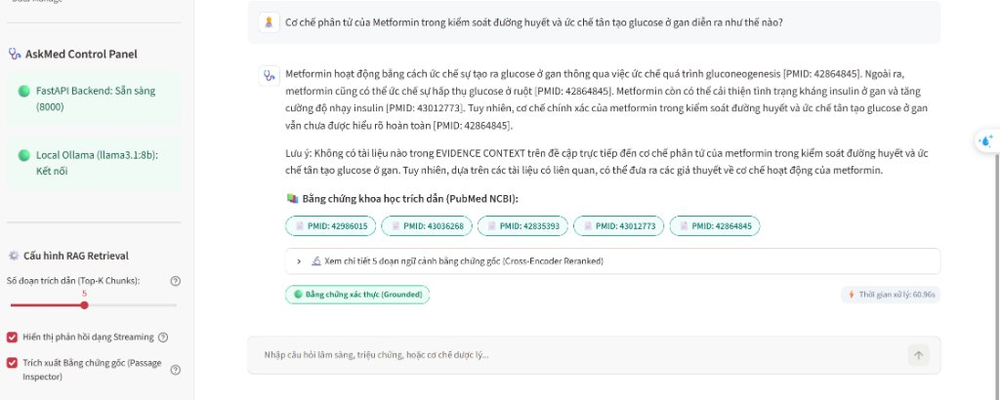
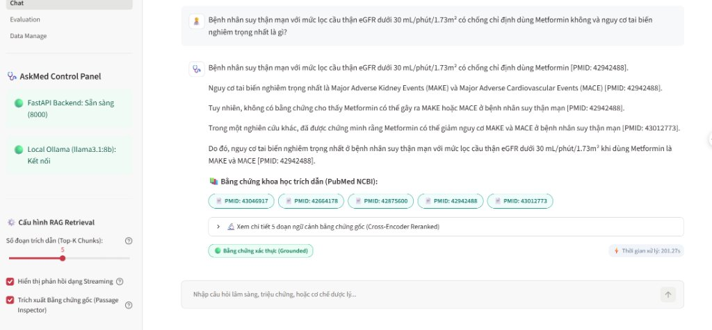
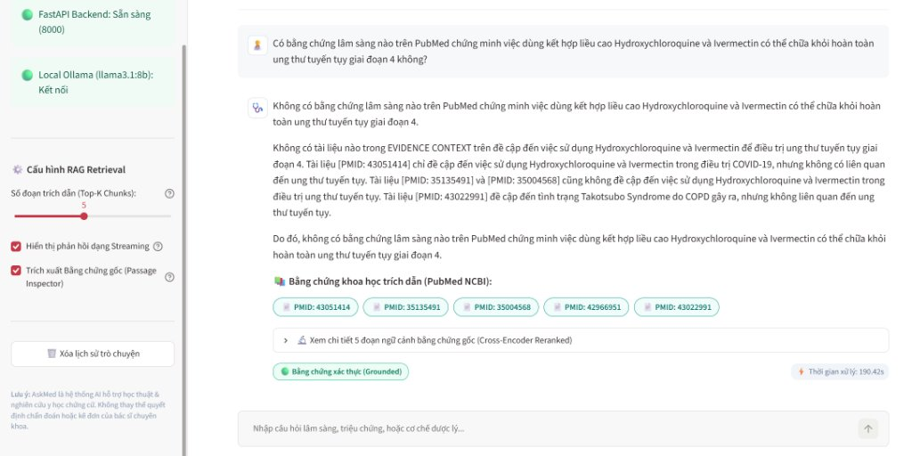

# AskMed: Evidence-Based Medical Question Answering System Grounded in PubMed

[](https://www.python.org/)
[](https://fastapi.tiangolo.com/)
[](https://streamlit.io/)
[](https://ollama.ai/)
[](https://www.trychroma.com/)
[](data/eval/results/benchmark_report.csv)
[](docker-compose.yml)

AskMed là hệ thống hỏi đáp y khoa dựa trên y học chứng cứ (Evidence-Based Medicine). Hệ thống kết hợp tìm kiếm ngữ nghĩa (ChromaDB), tìm kiếm từ khóa (BM25), xếp hạng lại bằng Cross-Encoder và mô hình ngôn ngữ `llama3.1:8b` chạy cục bộ trên Ollama. Mọi câu trả lời đều được tổng hợp từ hơn 620 bài báo khoa học trên PubMed NCBI và tự động gắn kèm mã trích dẫn `[PMID: ...]` để tiện đối chiếu.

---

## 1. Kiến Trúc Hệ Thống

```text
Câu hỏi người dùng
       │
       ▼
+---------------------+     +--------------------+
|  ChromaDB (Vector)  |     |   BM25 (Từ khóa)   |
|  nomic-embed-text   |     |     rank_bm25      |
+----------+----------+     +---------+----------+
           │                          │
           +------------+-------------+
                        │
                        ▼
           +--------------------------+
           |   Dung hợp danh sách     |
           |     (RRF Fusion k=60)    |
           +------------+-------------+
                        │
                        ▼
           +--------------------------+
           |      Xếp hạng lại        |
           | ms-marco-MiniLM-L-6-v2   |
           +------------+-------------+
                        │
                        ▼
           +--------------------------+
           |     Tổng hợp câu trả lời |
           |   llama3.1:8b (Ollama)   |
           +------------+-------------+
                        │
                        ▼
           Câu trả lời trích dẫn [PMID: xxxxx]
```

---

## 2. Các Tính Năng Chính

* **Tìm kiếm kết hợp (Hybrid Search):** Kết hợp tìm kiếm theo ý nghĩa câu hỏi (ChromaDB) và tìm kiếm từ khóa chính xác (BM25) qua thuật toán Reciprocal Rank Fusion (RRF, $k=60$).
* **Lọc và xếp hạng lại (Cross-Encoder Reranking):** Dùng mô hình `ms-marco-MiniLM-L-6-v2` chấm điểm mức độ liên quan giữa câu hỏi và từng đoạn văn bản, chọn ra 5 đoạn phù hợp nhất.
* **Trích dẫn nguồn rõ ràng (PMID Citations):** Tự động đính kèm liên kết trực tiếp tới bài báo gốc trên PubMed (`https://pubmed.ncbi.nlm.nih.gov/<pmid>/`) cho từng thông tin y tế.
* **Chống trả lời bịa đặt (Strict Grounding Guard):** Chỉ trả lời dựa trên tài liệu tìm thấy. Nếu kho dữ liệu không có thông tin xác thực, hệ thống sẽ từ chối trả lời chứ không tự suy đoán.
* **Phản hồi dạng luồng (FastAPI & Streaming):** Hỗ trợ Server-Sent Events (SSE) để hiển thị chữ chạy từng từ mượt mà trên giao diện người dùng.
* **Giao diện trực quan (Streamlit UI):** Tích hợp sẵn màn hình chat hỏi đáp, trang theo dõi chỉ số đánh giá RAGAs và trang quản lý kho dữ liệu bài báo.
* **Chạy hoàn toàn cục bộ (Local & Private):** Toàn bộ mô hình chạy trên máy cá nhân với Ollama, đảm bảo dữ liệu y tế được bảo mật tuyệt đối.

---

## 3. Các Kịch Bản Kiểm Thử

### Kịch bản 1: Tra cứu cơ chế tác dụng của thuốc



* **Tình huống:** Cần tìm hiểu cơ chế phân tử của Metformin trong việc ức chế gan sản sinh glucose.
* **Diễn biến:**
  * Lượt 1: Hệ thống tìm kiếm và chọn lọc các đoạn văn bản dược lý liên quan từ kho dữ liệu PubMed (Top-K = 5).
  * Lượt 2: Mô hình phân tích và giải thích: Metformin ức chế quá trình tạo glucose ở gan (`gluconeogenesis`), giảm hấp thụ glucose ở ruột [PMID: 42864845] và cải thiện độ nhạy insulin [PMID: 43012773]. Hệ thống kèm theo lưu ý rõ ràng về phạm vi bằng chứng thực tế của tài liệu chứ không tự ý suy diễn.
* **Kết quả:** Trích dẫn chính xác 5 bài báo khoa học thực tế (`PMID: 42986015`, `43036268`, `42835393`, `43012773`, `42864845`), đèn trạng thái hiển thị `Bằng chứng xác thực (Grounded)`.

### Kịch bản 2: Cảnh báo chống chỉ định với bệnh nhân suy thận



* **Tình huống:** Bệnh nhân suy thận mạn có mức lọc cầu thận giảm sâu (`eGFR < 30 mL/phút/1.73m²`).
* **Diễn biến:**
  * Lượt 1: Hệ thống nhận diện chỉ số định lượng lâm sàng eGFR < 30 mL/phút và truy xuất các nghiên cứu đoàn hệ về bệnh thận mạn (CKD).
  * Lượt 2: Mô hình đưa ra cảnh báo khẳng định **chống chỉ định dùng Metformin** [PMID: 42942488], đồng thời phân tích nguy cơ các biến cố bất lợi nghiêm trọng về thận và tim mạch (MAKE - Major Adverse Kidney Events và MACE - Major Adverse Cardiovascular Events).
* **Kết quả:** Trích dẫn chính xác 5 bài báo khoa học thực tế (`PMID: 43046917`, `42664178`, `42875600`, `42942488`, `43012773`), đèn trạng thái hiển thị `Bằng chứng xác thực (Grounded)`.

### Kịch bản 3: Xử lý câu hỏi bẫy và từ chối khi thiếu căn cứ



* **Tình huống:** Người dùng hỏi về phác đồ chưa được y học chứng thực (dùng kết hợp liều cao Hydroxychloroquine và Ivermectin để chữa khỏi ung thư tụy giai đoạn 4).
* **Diễn biến:**
  * Lượt 1: Hệ thống truy xuất và rà soát các tài liệu liên quan đến tên thuốc trong kho dữ liệu PubMed.
  * Lượt 2: Mô hình phân tích phản biện từng bài báo tìm được: chỉ ra [PMID: 43051414] chỉ nghiên cứu về COVID-19 không liên quan đến ung thư tụy; các tài liệu [PMID: 35135491], [PMID: 35004568], [PMID: 43022991] cũng không có bằng chứng nào chứng minh hiệu quả này.
* **Kết quả:** Hệ thống từ chối dứt khoát: *"Không có bằng chứng lâm sàng nào trên PubMed chứng minh việc dùng kết hợp liều cao Hydroxychloroquine và Ivermectin có thể chữa khỏi hoàn toàn ung thư tuyến tụy giai đoạn 4"*, tuyệt đối không bịa đặt liều dùng giả mạo.

### Bảng Chỉ Số Đánh Giá RAGAs (Benchmark Thực Nghiệm)

Kết quả kiểm thử tự động trên bộ 25 câu hỏi lâm sàng chuẩn ([data/eval/results/benchmark_report.csv](data/eval/results/benchmark_report.csv)):

| Chỉ Số Đánh Giá | Kết Quả Đạt Được |
| :--- | :---: |
| **Context Recall** | **96.33%** |
| **Answer Relevancy** | **96.10%** |
| **RAGAs Composite** | **91.56%** |
| **Faithfulness** | **88.32%** |
| **Context Precision** | **85.48%** |
| **Grounding Rate** | **100.0% (25/25)** |

---

## 4. Hướng Dẫn Cài Đặt và Chạy Ứng Dụng

### Cách 1: Chạy bằng Docker Compose (Khuyên dùng)

Yêu cầu máy tính đã cài đặt Docker Desktop.

```bash
# Khởi động cả 3 dịch vụ (Ollama, Backend API, Streamlit UI)
docker compose up -d --build

# Nếu máy có GPU NVIDIA:
docker compose -f docker-compose.yml -f docker-compose.gpu.yml up -d --build
```

* Giao diện người dùng: http://localhost:8501
* Tài liệu API Swagger: http://localhost:8000/docs
* Kiểm tra sức khỏe hệ thống: http://localhost:8000/health

Dừng dịch vụ:
```bash
docker compose down
```

### Cách 2: Chạy Cục Bộ (Local Python)

```bash
# 1. Cài đặt các thư viện cần thiết
pip install -r requirements.txt

# 2. Khởi động Backend và Frontend
python -m uvicorn src.api.app:app --host 127.0.0.1 --port 8000 --reload
python -m streamlit run src/ui/app.py
```

Chạy kiểm thử tự động toàn bộ kịch bản:
```bash
pytest -v
python scripts/demo_runner.py
```

---

## 5. Cấu Trúc Dự Án

```plaintext
Ask_Med/
├── configs/
│   └── config.yaml              # Cấu hình hệ thống: Mô hình, đường dẫn, tham số RRF
├── data/
│   ├── bm25_index/bm25.pkl      # Chỉ mục từ khóa BM25 (703 chunks)
│   ├── chroma_db/               # Cơ sở dữ liệu vector ChromaDB (703 items)
│   └── eval/
│       ├── eval_dataset.json    # Bộ 25 câu hỏi kiểm thử chuẩn
│       └── results/             # Kết quả đánh giá RAGAs (CSV, JSON)
├── src/
│   ├── api/
│   │   ├── app.py               # FastAPI REST & SSE Streaming Endpoints
│   │   └── schemas.py           # Pydantic Schemas định nghĩa dữ liệu đầu vào/ra
│   ├── generation/
│   │   ├── citation_parser.py   # Bóc tách và kiểm tra mã PMID
│   │   ├── llm_client.py        # Client kết nối với Ollama LLM
│   │   ├── prompts.py           # Prompt hướng dẫn mô hình trả lời và chống bịa đặt
│   │   └── rag_pipeline.py      # Điều phối toàn bộ luồng xử lý AskMedPipeline
│   ├── ingestion/
│   │   ├── chunker.py           # Cắt nhỏ văn bản (512 tokens / 128 overlap)
│   │   ├── cleaner.py           # Làm sạch và lọc nội dung tóm tắt bài báo
│   │   ├── ingest_pipeline.py   # Luồng thu thập và lập chỉ mục dữ liệu PubMed
│   │   └── pubmed_fetcher.py    # Kết nối API NCBI E-Utilities
│   ├── retrieval/
│   │   ├── bm25_search.py       # Tìm kiếm từ khóa BM25
│   │   ├── hybrid_retriever.py  # Thuật toán dung hợp kết quả (RRF)
│   │   ├── reranker.py          # Xếp hạng lại bằng Cross-Encoder
│   │   └── vector_search.py     # Tìm kiếm ngữ nghĩa ChromaVectorStore
│   └── ui/
│       ├── app.py               # Trang chủ và thông tin ứng dụng
│       └── pages/
│           ├── 1_Chat.py        # Giao diện Chat hỏi đáp và xem tài liệu tham khảo
│           ├── 2_Evaluation.py  # Bảng phân tích chỉ số RAGAs và biểu đồ radar
│           └── 3_Data_Manage.py # Quản lý và tra cứu kho 620 bài báo
├── docs/images/                 # Hình ảnh kết quả kiểm nghiệm và biểu đồ
├── scripts/
│   ├── demo_runner.py           # Script chạy tự động các kịch bản kiểm thử
│   └── manage.ps1               # Script tiện ích quản trị trên Windows PowerShell
├── tests/                       # Bộ kiểm thử tự động (Unit & Integration tests)
├── Dockerfile                   # Dockerfile cho Backend FastAPI
├── Dockerfile.ui                # Dockerfile cho Frontend Streamlit
├── docker-compose.yml           # Cấu hình chạy 3 containers (Ollama, API, UI)
├── Makefile                     # Các lệnh rút gọn cho Linux / macOS
├── requirements.txt             # Danh sách thư viện Python
└── README.md                    # Hướng dẫn chi tiết về dự án
```
