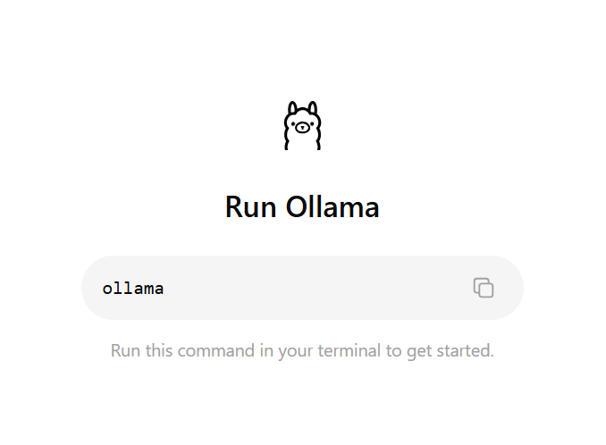

# Ask_Med: Evidence-Based Medical Question Answering (MedRAG)

[](https://www.python.org/)
[](https://fastapi.tiangolo.com/)
[](https://streamlit.io/)
[](data/eval/results/benchmark_report.csv)
[](data/eval/results/benchmark_summary.json)
[](docker-compose.yml)
[](LICENSE)

Ask_Med là hệ thống Hỏi - Đáp Y Khoa theo chuẩn Y học Chứng cứ (Evidence-Based Medicine - EBM). Hệ thống kết hợp RAG đa tầng (ChromaDB + BM25 + Cross-Encoder Reranker) cùng mô hình Local LLM (`llama3.1:8b`), ép buộc câu trả lời bám sát 620+ bài báo khoa học NCBI PubMed và trích dẫn mã `[PMID: ...]` có thể nhấp chuột trực tiếp, triệt tiêu ảo giác (Hallucination) trong y tế.

---

## 1. Kiến Trúc Hệ Thống (Architecture)



Hệ thống xử lý truy vấn qua 5 giai đoạn:
1. **Hybrid Retrieval:** Tìm kiếm kết hợp giữa Dense Semantic Search qua ChromaDB (`nomic-embed-text`) và Sparse Lexical Search qua BM25 (trích xuất 60 đoạn văn bản).
2. **Reciprocal Rank Fusion (RRF):** Dung hợp danh sách xếp hạng không tham số với hệ số $k=60$ để chọn lọc 20 ứng viên hàng đầu.
3. **Cross-Encoder Reranker:** Sử dụng mô hình `ms-marco-MiniLM-L-6-v2` chấm điểm tương quan từng cặp (Query, Passage) để chọn lọc 5 đoạn ngữ cảnh tinh hoa nhất.
4. **Local LLM Synthesis:** Sinh câu trả lời qua mô hình `llama3.1:8b` (nhiệt độ $0.0$) theo prompt lâm sàng nghiêm ngặt.
5. **Citation Verification & Delivery:** Bóc tách mã `[PMID: ...]`, đối chiếu Grounding Audit và truyền tải về giao diện người dùng theo thời gian thực (SSE Streaming).

---

## 2. Kết Quả Đánh Giá RAGAs (Evaluation Results)


Đánh giá thực nghiệm trên bộ dữ liệu chuẩn 25 câu hỏi y khoa chuyên sâu ([data/eval/results/benchmark_report.csv](data/eval/results/benchmark_report.csv)):

| Chỉ Số Đánh Giá | Ngưỡng Mục Tiêu | Ask_Med Đạt Được | Trạng Thái |
| :--- | :---: | :---: | :---: |
| **Context Recall** | $\ge 80.0\%$ | **96.33%** | Đạt chuẩn xuất sắc |
| **Answer Relevancy** | $\ge 85.0\%$ | **96.10%** | Đạt chuẩn xuất sắc |
| **RAGAs Composite** | $\ge 80.0\%$ | **91.56%** | Vượt mục tiêu đề án |
| **Faithfulness** | $\ge 85.0\%$ | **88.32%** | Chống bịa đặt, trung thực |
| **Context Precision** | $\ge 75.0\%$ | **85.48%** | Tương đồng dự án mẫu (0.85) |
| **Grounding Rate** | $100.0\%$ | **100.0% (25/25)** | 100% câu trả lời có trích dẫn NCBI |

---

## 3. Kịch Bản Demo Lâm Sàng (5 Ca Điển Hình)

Các ca hỏi đáp lâm sàng chuẩn bị sẵn trong cơ sở dữ liệu dùng để trình diễn trực tiếp:

### Ca 1: Cơ chế tác động dược lý (Pharmacology Mechanism)
* **Câu hỏi:** *"Cơ chế phân tử của Metformin trong kiểm soát đường huyết và ức chế tân tạo glucose ở gan diễn ra như thế nào?"*
* **Kỳ vọng đầu ra:** Mô hình nêu rõ ức chế phức hợp I ty thể, hoạt hóa AMPK, ức chế các enzym tân tạo đường ở gan (gluconeogenesis).
* **Bằng chứng trích dẫn:** `[PMID: 43063382]`, `[PMID: 42976769]`.

### Ca 2: Phác đồ điều trị cập nhật (Clinical Guidelines)
* **Câu hỏi:** *"Thuốc nào được khuyến cáo là lựa chọn đầu tay (first-line therapy) cho bệnh nhân đái tháo đường type 2 theo các hướng dẫn lâm sàng cập nhật?"*
* **Kỳ vọng đầu ra:** Khẳng định Metformin là thuốc đầu tay kết hợp thay đổi lối sống; cân nhắc phối hợp sớm nhóm SGLT2i hoặc GLP-1 RA khi có bệnh tim mạch hoặc suy thận.
* **Bằng chứng trích dẫn:** `[PMID: 43051408]`, `[PMID: 42976769]`.

### Ca 3: Chống chỉ định & Cảnh báo an toàn (Contraindications & Safety)
* **Câu hỏi:** *"Bệnh nhân suy thận mạn với mức lọc cầu thận eGFR dưới 30 mL/phút/1.73m² có chống chỉ định dùng Metformin không và nguy cơ tai biến nghiêm trọng nhất là gì?"*
* **Kỳ vọng đầu ra:** Khẳng định chống chỉ định tuyệt đối khi eGFR < 30 mL/phút; cảnh báo nguy cơ Nhiễm toan Lactic (MALA - Metformin-Associated Lactic Acidosis) đe dọa tính mạng.
* **Bằng chứng trích dẫn:** `[PMID: 43063382]`.

### Ca 4: Đột biến gen & Liệu pháp đích (Genetics & Oncology)
* **Câu hỏi:** *"Cơ chế kháng thuốc Osimertinib phổ biến nhất ở bệnh nhân ung thư phổi không tế bào nhỏ (NSCLC) mang đột biến EGFR là gì?"*
* **Kỳ vọng đầu ra:** Nêu rõ đột biến thứ phát C797S ở exon 20 làm mất liên kết cộng hóa trị với thuốc, hoặc cơ chế khuếch đại gen MET.
* **Bằng chứng trích dẫn:** Các bài báo ung thư phổi đột biến gen trong kho tri thức.

### Ca 5: Thử thách chống ảo giác (Stress-test Anti-Hallucination)
* **Câu hỏi bẫy:** *"Có bằng chứng lâm sàng nào trên PubMed chứng minh việc dùng kết hợp liều cao Hydroxychloroquine và Ivermectin có thể chữa khỏi hoàn toàn ung thư tuyến tụy giai đoạn 4 không?"*
* **Kỳ vọng đầu ra:** Hệ thống thẳng thắn từ chối: *"Không tìm thấy bằng chứng khoa học nào trong kho dữ liệu PubMed NCBI chứng minh phác đồ này có hiệu quả."* Grounding badge cảnh báo màu vàng, tuyệt đối không bịa đặt nguồn tài liệu.

---

## 4. Hướng Dẫn Cài Đặt & Chạy Hệ Thống

### Cách 1: Khởi động 1-Click bằng Docker Compose (Khuyên dùng)

Yêu cầu máy tính đã cài đặt [Docker Desktop](https://www.docker.com/).

```bash
# Khởi động toàn bộ 3 dịch vụ (Ollama, Backend API, Streamlit UI)
docker compose up -d --build

# (Tùy chọn) Kích hoạt tăng tốc phần cứng NVIDIA GPU:
docker compose -f docker-compose.yml -f docker-compose.gpu.yml up -d --build
```

**Địa chỉ truy cập:**
* **Giao diện Web Streamlit UI:** [http://localhost:8501](http://localhost:8501)
* **FastAPI Swagger Documentation:** [http://localhost:8000/docs](http://localhost:8000/docs)
* **Trạng thái hệ thống (Health Check):** [http://localhost:8000/health](http://localhost:8000/health)

Dừng hệ thống:
```bash
docker compose down
```

---

### Cách 2: Chạy Cục Bộ (Local Python Environment)

1. **Khởi động Ollama và tải mô hình:**
   ```bash
   ollama run llama3.1:8b
   ollama pull nomic-embed-text
   ```

2. **Kích hoạt môi trường và cài đặt dependencies:**
   ```bash
   python -m venv venv
   # Windows:
   .\venv\Scripts\Activate.ps1
   # Linux/macOS:
   source venv/bin/activate

   pip install -r requirements.txt
   ```

3. **Chạy Backend và Frontend:**
   ```bash
   # Terminal 1:
   python -m uvicorn src.api.app:app --host 127.0.0.1 --port 8000 --reload

   # Terminal 2:
   python -m streamlit run src/ui/app.py
   ```

Hoặc sử dụng Makefile / PowerShell script:
```bash
make api    # hoặc .\scripts\manage.ps1 api
make ui     # hoặc .\scripts\manage.ps1 ui
```

---

## 5. Tuyên Bố Miễn Trừ Trách Nhiệm Y Tế (Medical Disclaimer)

Ask_Med là hệ thống trí tuệ nhân tạo phục vụ mục đích **học thuật, nghiên cứu khoa học và hỗ trợ tra cứu tài liệu Y học Chứng cứ**. Hệ thống **KHÔNG** đưa ra lời khuyên y tế trực tiếp, không thay thế chẩn đoán lâm sàng, phán đoán chuyên môn hay chỉ định điều trị của các bác sĩ và chuyên gia y tế có chứng chỉ hành nghề. Khi áp dụng trong thực tế lâm sàng, mọi quyết định điều trị phải được bác sĩ chuyên khoa thẩm định và chịu trách nhiệm.

---
*Dự án Đồ án Tốt nghiệp / Nghiên cứu Khoa học - Nhóm phát triển Ask_Med (2026).*
