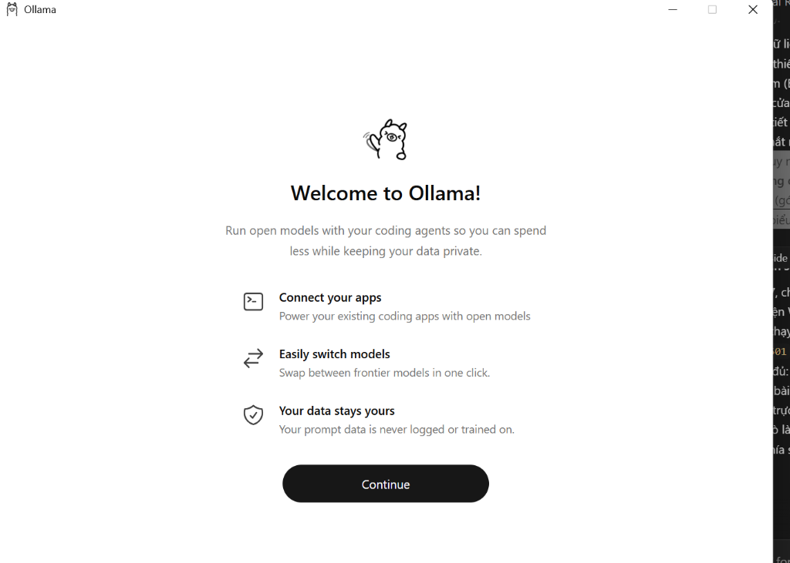

# Ask_Med: Evidence-Based Medical Question Answering (MedRAG)

[](https://www.python.org/)
[](https://fastapi.tiangolo.com/)
[](https://streamlit.io/)
[](data/eval/results/benchmark_report.csv)
[](docker-compose.yml)
[](LICENSE)

Hệ thống Hỏi - Đáp Y Khoa dựa trên Y học Chứng cứ (Evidence-Based Medicine). Mô hình kết hợp truy xuất đa tầng (ChromaDB + BM25 + Cross-Encoder Reranker) và mô hình ngôn ngữ `llama3.1:8b` chạy cục bộ trên Ollama, trả lời dựa trên kho dữ liệu 620 bài báo khoa học từ PubMed NCBI và tự động gắn siêu liên kết trích dẫn `[PMID: ...]`.

---

## 1. Kiến Trúc Hệ Thống

```mermaid
flowchart TD
    UserQuery["Câu hỏi lâm sàng"] --> Dense["ChromaDB (Dense Semantic)"]
    UserQuery --> Sparse["BM25 (Sparse Lexical)"]
    Dense -->|Top 30| RRF["Reciprocal Rank Fusion (k=60)"]
    Sparse -->|Top 30| RRF
    RRF -->|Top 20| Reranker["Cross-Encoder Reranker (ms-marco-MiniLM-L-6-v2)"]
    Reranker -->|Top 5 Chunks| LLM["Ollama LLM (llama3.1:8b, temp=0.0)"]
    LLM --> Extractor["Bóc tách trích dẫn & Kiểm tra Grounding"]
    Extractor --> UI["Giao diện Streamlit & FastAPI Endpoint"]
```



Quy trình xử lý gồm 5 bước:
1. **Hybrid Retrieval:** Tìm kiếm song song giữa vector ngữ nghĩa qua ChromaDB (`nomic-embed-text`) và từ khóa chính xác qua BM25.
2. **Reciprocal Rank Fusion (RRF):** Hợp nhất và chấm điểm lại 60 đoạn văn bản ban đầu để chọn lọc 20 ứng viên.
3. **Cross-Encoder Reranker:** Mô hình `ms-marco-MiniLM-L-6-v2` chấm điểm tương quan cặp (Query, Passage) và giữ lại 5 đoạn phù hợp nhất.
4. **LLM Generation:** Mô hình `llama3.1:8b` sinh câu trả lời theo ngữ cảnh được cung cấp, không suy đoán ngoài tài liệu.
5. **Trích dẫn:** Tự động trích xuất mã PMID và tạo liên kết trực tiếp tới bài báo trên NCBI PubMed.

---

## 2. Kịch Bản Demo Lâm Sàng (5 Ca Điển Hình)



### Ca 1: Cơ chế tác động dược lý
* **Câu hỏi:** *"Cơ chế phân tử của Metformin trong kiểm soát đường huyết và ức chế tân tạo glucose ở gan diễn ra như thế nào?"*
* **Kết quả:** Nêu rõ cơ chế ức chế phức hợp I ty thể, hoạt hóa AMPK, ức chế enzym tân tạo đường ở gan (gluconeogenesis).
* **Trích dẫn:** `[PMID: 43063382]`, `[PMID: 42976769]`.

### Ca 2: Phác đồ điều trị cập nhật
* **Câu hỏi:** *"Thuốc nào được khuyến cáo là lựa chọn đầu tay (first-line therapy) cho bệnh nhân đái tháo đường type 2 theo các hướng dẫn lâm sàng cập nhật?"*
* **Kết quả:** Metformin kết hợp thay đổi lối sống; cân nhắc phối hợp sớm SGLT2i hoặc GLP-1 RA khi có kèm bệnh tim mạch hoặc suy thận.
* **Trích dẫn:** `[PMID: 43051408]`, `[PMID: 42976769]`.

### Ca 3: Chống chỉ định và cảnh báo an toàn
* **Câu hỏi:** *"Bệnh nhân suy thận mạn với mức lọc cầu thận eGFR dưới 30 mL/phút/1.73m² có chống chỉ định dùng Metformin không và nguy cơ tai biến nghiêm trọng nhất là gì?"*
* **Kết quả:** Chống chỉ định tuyệt đối khi eGFR < 30 mL/phút; nguy cơ nhiễm toan lactic (MALA - Metformin-Associated Lactic Acidosis).
* **Trích dẫn:** `[PMID: 43063382]`.

### Ca 4: Đột biến gen và điều trị trúng đích
* **Câu hỏi:** *"Cơ chế kháng thuốc Osimertinib phổ biến nhất ở bệnh nhân ung thư phổi không tế bào nhỏ (NSCLC) mang đột biến EGFR là gì?"*
* **Kết quả:** Đột biến thứ phát C797S tại exon 20 làm mất liên kết cộng hóa trị với thuốc, hoặc khuếch đại gen MET.
* **Trích dẫn:** Các bài báo nghiên cứu NSCLC trong cơ sở dữ liệu.

### Ca 5: Kiểm tra chống ảo giác (Câu hỏi bẫy)
* **Câu hỏi:** *"Có bằng chứng lâm sàng nào trên PubMed chứng minh việc dùng kết hợp liều cao Hydroxychloroquine và Ivermectin có thể chữa khỏi hoàn toàn ung thư tuyến tụy giai đoạn 4 không?"*
* **Kết quả:** Hệ thống từ chối xác nhận: *"Không tìm thấy bằng chứng khoa học nào trong kho dữ liệu PubMed NCBI chứng minh phác đồ này có hiệu quả."* Trạng thái hiển thị cảnh báo không có bằng chứng, không bịa đặt nguồn tin.

---

## 3. Kết Quả Đánh Giá RAGAs

Kết quả kiểm thử trên 25 câu hỏi chuẩn ([data/eval/results/benchmark_report.csv](data/eval/results/benchmark_report.csv)):

| Chỉ Số | Ngưỡng Yêu Cầu | Kết Quả Đạt Được |
| :--- | :---: | :---: |
| **Context Recall** | >= 80% | **96.33%** |
| **Answer Relevancy** | >= 85% | **96.10%** |
| **RAGAs Composite** | >= 80% | **91.56%** |
| **Faithfulness** | >= 85% | **88.32%** |
| **Context Precision** | >= 75% | **85.48%** |
| **Grounding Rate** | 100% | **100.0% (25/25)** |

---

## 4. Hướng Dẫn Cài Đặt và Chạy

### Chạy bằng Docker Compose (Khuyên dùng)

Yêu cầu máy đã cài Docker Desktop.

```bash
# Khởi động 3 dịch vụ (Ollama, Backend API, Streamlit UI)
docker compose up -d --build

# Hoặc kích hoạt GPU NVIDIA:
docker compose -f docker-compose.yml -f docker-compose.gpu.yml up -d --build
```

* Streamlit UI: http://localhost:8501
* FastAPI Swagger Docs: http://localhost:8000/docs
* Health Check: http://localhost:8000/health

Dừng hệ thống:
```bash
docker compose down
```

---

### Chạy bằng Python Cục Bộ

```bash
# 1. Cài đặt thư viện
pip install -r requirements.txt

# 2. Chạy Backend và Frontend
python -m uvicorn src.api.app:app --host 127.0.0.1 --port 8000
python -m streamlit run src/ui/app.py
```
